# DevTextTools

One offline Windows program that does what ten online tool sites do — text tools, developer tools, encoders, hashes, generators, converters and calculators — with no browser, no uploads, and no internet needed.

## TL;DR

Imagine you keep visiting ten different websites whenever you need to fix up some text, check a code snippet, convert a measurement, or make a random password — and every time, you paste your stuff into a stranger's website. DevTextTools is all of those little tools in one program on your own PC. You pick a tool from the list, paste or type in the box, press Run, and copy the answer out. Nothing you type ever leaves your computer.

## Key features

- **238 tools in one window**, grouped as: Case, Lines, Transform, Analyse, Encode / Decode, Developer / Format, Hash / Crypto, Generators, Converters, Calculators
- **Search box** — type part of a tool's name or what it does ("json", "sort", "sha", "roman", "subnet") and the list filters instantly
- **Chain tools** — "Output → Input" feeds one tool's result into the next, like the multi-step pipelines on the tool sites
- **Built for developers** — star your daily tools into a ★ Favorites tab (a ◷ Recent tab tracks your last 10 runs), press **Ctrl+K** to jump to any tool by keyboard, drag & drop files straight onto the window (a dropped PDF shows its info), chain tools into saved **Pipelines**, and test patterns live in the **Regex Lab** with matches highlighted as you type. Favorites, recents and pipelines are remembered between sessions
- **Work like a developer** — multiple **work tabs** (each keeps its own tool and text), **Undo/Redo** for whole actions, **smart paste** that recognises JSON/JWTs/hashes/stack traces and offers the right tools, an opt-in **auto-run on paste**, a **snippet library**, **batch runs** over many files, a project-wide **find & replace** view with preview, and a **JSON tree explorer** with copyable paths
- **Same tools in a command line** — every tool also runs from a terminal (see *Command line* below), so scripts can use them too; there are no window-only tools
- **Fully offline, private by design** — no account, no tracking code from us, no network calls; password and hash tools work on your machine only
- **Free, no ads, no in-app purchases** — optional donations only, per the house rule for all of SEAN's software

## Features in detail

All screenshots below are real captures from the author's Windows PC running v0.6.1 — no mockups, no placeholders. The window was restyled in v0.7.0 (Terminal design: green accent, monospace text, History rail) and refined in v0.7.1 (toolbars that stretch to fill their space and a minimum window size), so the layout in these captures differs from the current build; new captures are to be added.

### The Tools workspace

Category tabs across the top, the category's tools as a ribbon of buttons underneath (tall categories scroll inside the ribbon), and a plain Input → Output workspace. Around it: a search box that filters tools as you type, multiple **work tabs** (each keeps its own tool and text), **Undo/Redo** for whole actions, **★ Favorites** and **◷ Recent** tabs, **Ctrl+K** quick-jump, a **snippet library** for reusable inputs, **smart paste** chips that recognise JSON/JWTs/hashes/stack traces and offer the matching tools, an opt-in **auto-run on paste**, **batch runs** over many files, and drag & drop (a dropped PDF shows its info).

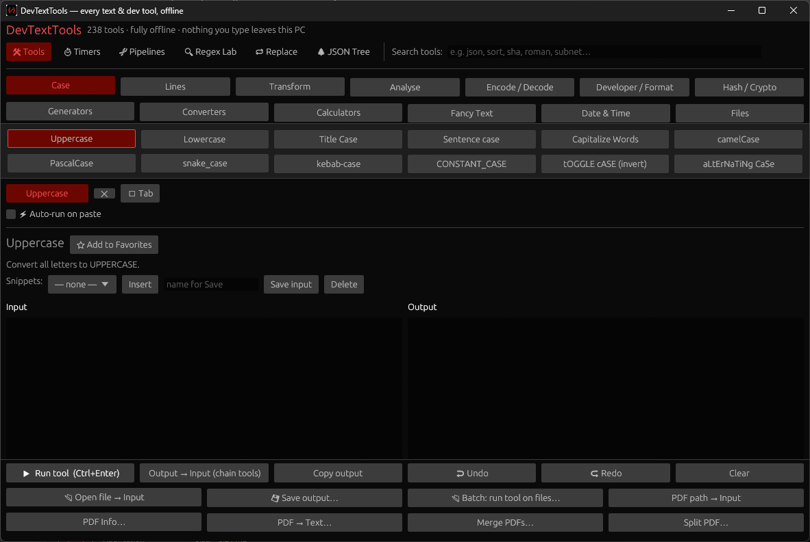

### Case, lines and transforms

- **Case:** UPPERCASE, lowercase, Title, Sentence, camelCase, PascalCase, snake_case, kebab-case, CONSTANT_CASE, tOGGLE, aLtErNaTiNg
- **Lines:** sort (A→Z, Z→A, by length, numeric), reverse, shuffle, remove duplicates (incl. ignore-case), remove empty lines, keep/remove lines containing…, add prefix/suffix, add/remove line numbers, trim, wrap, unwrap, sort/dedupe words, line-endings inspector/converter

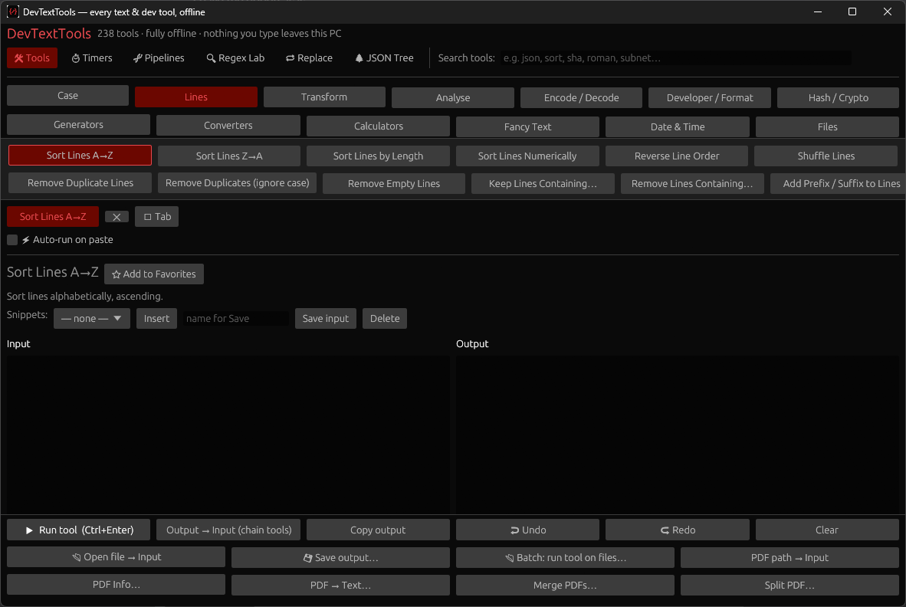

- **Transform:** reverse text/words/each word, repeat, remove spaces/punctuation/numbers/vowels/accents, strip HTML, slugify, ROT13, Caesar, Pig Latin, upside-down, leet, Morse encode/decode, NATO alphabet, fancy Unicode text styles

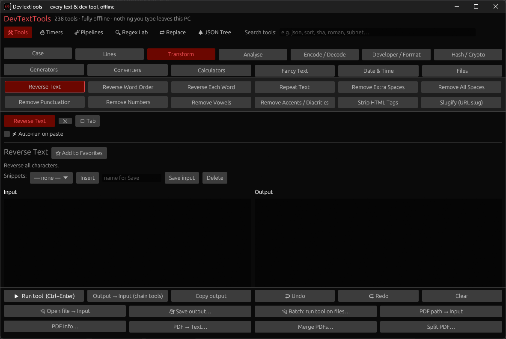

### Analyse

Character/word/line/sentence counts + reading time, word & letter frequency, find & replace (plain and regex), grep, extract emails/URLs/numbers, text diff, unified-diff (patch) export, edit distance, longest/shortest lines, a **log file analyzer** (level counts, busiest repeats, time span) and a **stack trace cleaner** (folds repeats, shortens paths).

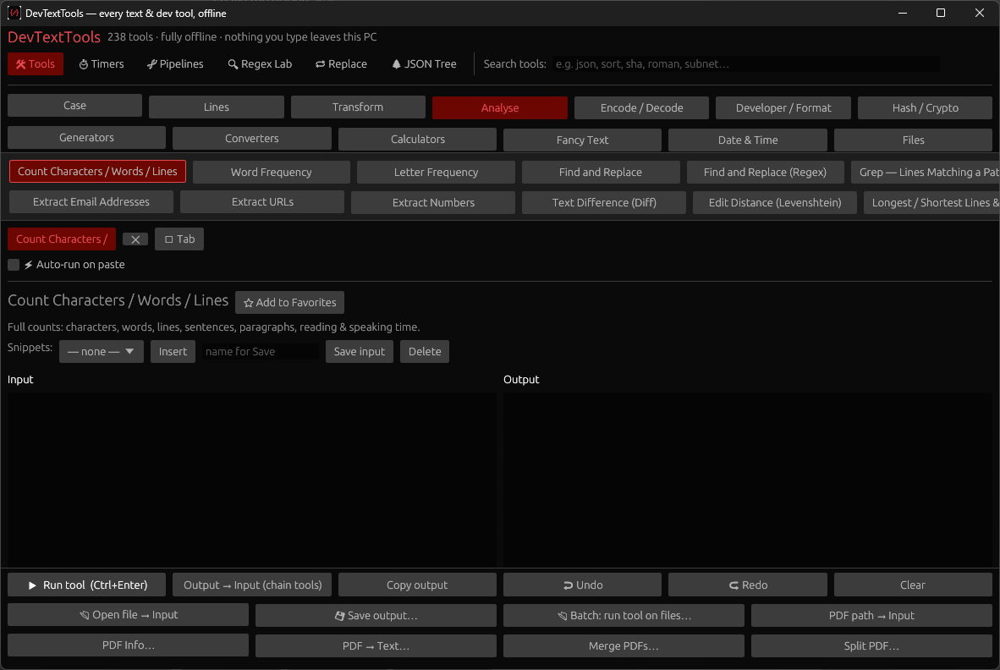

### Encode / Decode

Base64 (+URL-safe), Base32, hex, binary, URL, HTML entities, Unicode escapes, code points, decimal bytes, quoted-printable, string escape/unescape — plus a **mojibake fixer** for broken UTF-8 and an **invisible character revealer** that shows hidden characters as tags.

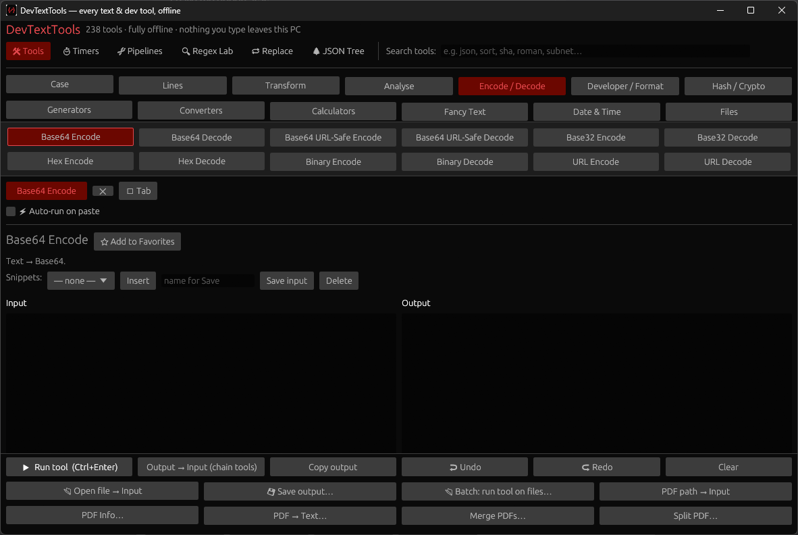

### Hash / Crypto

MD5, SHA-1, SHA-256, SHA-384, SHA-512, all-at-once, CRC32, HMAC-SHA256. (MD5 and SHA-1 are labelled in the app as checksums only — not safe for passwords.)

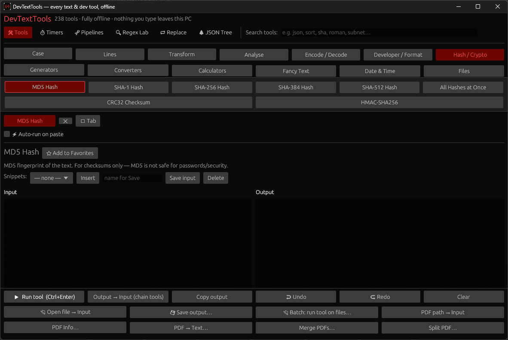

### Developer / Format

JSON format/minify/validate/stats, JSON↔CSV, JSON→YAML, JSON↔query string, XML format, SQL format (basic), CSS minify (basic), JWT decoder **and JWT builder/signer (HS256)**, regex tester **and regex explainer**, cron explainer, URL parser, .env sorter, UUID validator, CSS color formats, hash identifier, JSONPath queries, JSON Schema check (basic), TOML ↔ JSON, JSON → TypeScript types, curl → Python/fetch code, mystery-number identifier, JSON structural diff, INI/.env converters with compare & merge, mock-data generator, SQL helpers (IN lists, CREATE TABLE from data, placeholder expansion), .gitignore generator, commit-message checker, changelog maker.

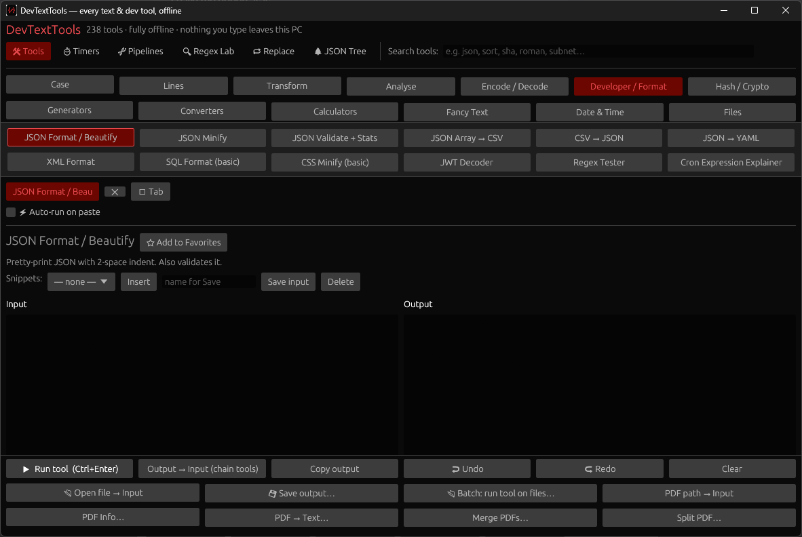

### Timers

Stopwatch, countdown, and a Pomodoro timer (25 minutes focus / 5 minutes break, session counter).

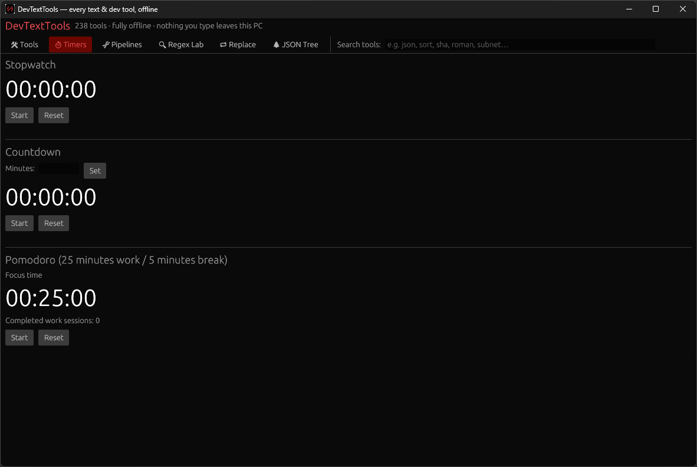

### Pipelines

Chain tools so each step's output feeds the next, and save named chains for reuse — they are remembered between sessions.

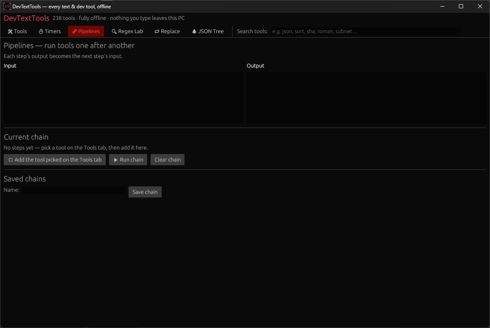

### Regex Lab

A live pattern tester: matches light up in the test text as you type, capture groups are listed, and named patterns can be saved into a small library.

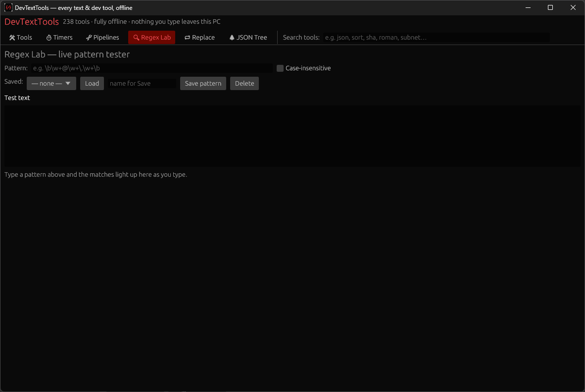

### Project find & replace

Search a whole folder of text files and preview every match before anything is written — Apply only touches the files the preview found. Plain text or regex, with an extension filter; `.git`, `target` and `node_modules` folders are skipped.

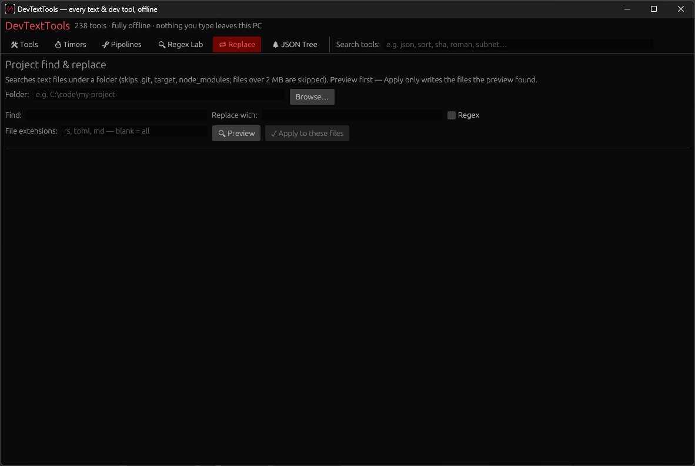

### JSON Tree Explorer

Paste JSON (or load it from the Tools tab) and browse it as a fold-out tree; every value has a copy-the-path button that gives you its JSONPath.

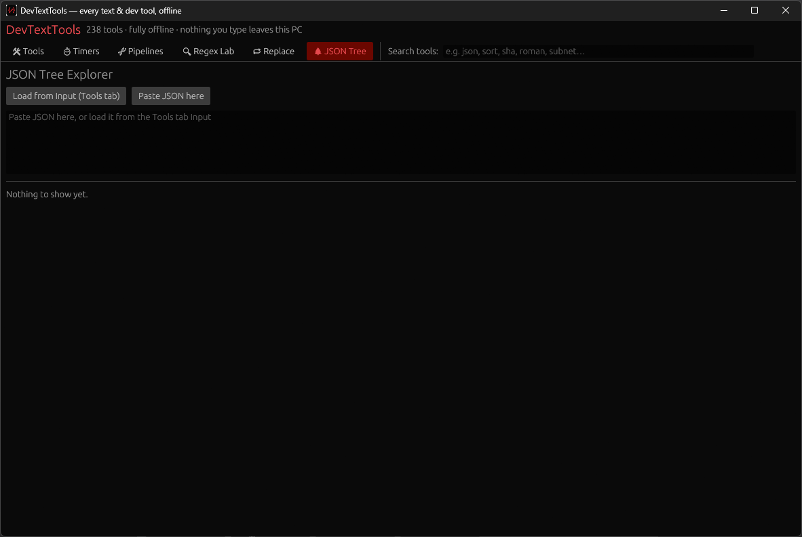

### Generators, converters, calculators and files

- **Generators:** UUID / GUID, password (+ strength check), random string/number/color, Lorem Ipsum, dice roller, coin flipper, random picker
- **Converters:** number bases 2–36, Roman numerals both ways, temperature, length, weight, area, volume, speed, time, data storage, pressure, energy, angle, Unix timestamp↔date, bytes human-readable, number→words, decimal→fraction, color HEX↔RGB/HSL + invert/lighten/complement/palette, aspect ratio
- **Calculators:** expression calculator (with sqrt/sin/log/…), percentage + % change, statistics, average, factorial, Fibonacci, GCD/LCM, primes, tip & split, BMI, age/date difference, IPv4 subnet, discount, loan/mortgage payment, compound interest
- **Files & PDFs:** file hash/info, file → Base64, PDF info, PDF text extraction, PDF merge and split

Per-site coverage and honest gaps are in [docs/COVERAGE.md](docs/COVERAGE.md); planned additions in [docs/ROADMAP.md](docs/ROADMAP.md).

## Requirements

- Windows 10 or 11, 64-bit (the program itself is built and tested from source on Linux in development; the Windows build is produced by cross-compiling — see *Verified status*)
- No internet, account, or install rights needed for the portable build

## Install / setup

1. Download the release for Windows: the installer `.exe`, or the portable `.zip`.
2. Portable: unzip anywhere, run `DevTextTools.exe`. Installer: run it and follow the steps.
3. The binaries are **unsigned** (no code-signing certificate) — Windows may show a "Windows protected your PC" prompt; choose *More info → Run anyway* if you trust this build, which you can verify against the source here.

## How to use it

1. Open DevTextTools. Pick a category tab at the top, then click the tool's button in the ribbon under the tabs — or type in the Search box.
2. Paste/type your text in **Input**. If the tool shows a **Parameter** box, fill it using the format shown under it (multiple values are separated with `|||` — for example Find and Replace uses `find|||replace`).
3. Press **Run tool** (or Ctrl+Enter). The answer appears in **Output**.
4. **Copy output** copies it; **Output → Input** sends it into the next tool.

## Command line

The same tools, without the window (text goes in through standard input, the result comes out as standard output):

```
devtexttools --list
devtexttools --search roman
echo hello world | devtexttools case-upper
echo 255 | devtexttools conv-base --param 10|||16
```

## Build instructions (developers)

- Needs a Rust toolchain (1.80+). Build and test: `cargo test --locked` (full suite — library + integration tests), then `cargo build --release --locked`.
- Windows cross-build from Linux: add the `x86_64-pc-windows-gnu` target and the mingw-w64 linker, then `cargo build --release --locked --target x86_64-pc-windows-gnu`.
- Structure: `src/lib.rs` + `src/ops/` hold every tool as a small pure function registered in one list (`src/ops/mod.rs`); `src/main.rs` is the window + the command line, both dispatching through that same list.

## Tests

`cargo test --locked` runs the full suite: registry checks (every tool has a unique ID, 238 tools), known-answer tests (hash test vectors from the official RFCs, Roman numerals, base conversion, subnet math, JSON/CSV round trips, Morse, edit distance) and error-path tests (bad input must produce a plain-words error, never a crash or a fake answer).

## Security / privacy / data / network

- DevTextTools makes **no network calls at all**. Text you paste — including passwords you check or hash — never leaves the PC.
- The only thing ever written to disk is a small settings file (favorites, recent tools, pipelines, snippets, saved patterns) in your local app-data folder. Your Input/Output text itself is never saved.
- Hash tools are checksums/fingerprints; MD5 and SHA-1 are labelled in-app as not safe for passwords or new security uses. The JWT decoder says plainly that decoding is not verification; the separate JWT builder signs with HS256 on your machine.

## Limitations and known issues

- Image, video and audio tools from those sites are **not** included (the program is text-first), and neither are most per-language code formatters — see `docs/COVERAGE.md` and `docs/ROADMAP.md`. PDFs are covered for info, text extraction, merge and split.
- SQL and CSS formatting are *basic* (keyword/whitespace level), labelled as such in the app.
- The password generator uses a time-seeded random generator; the in-app text itself recommends a password manager's generator for high-stakes secrets.
- Watching other programs' clipboards system-wide is not included: the auto-run option covers text pasted *into* DevTextTools.

## Verified status

- Core library + all tools: **Partially Verified** — the full test suite passes in the development environment (40 tests at v0.6.1) and every tool is also exercised from the command line.
- Windows `.exe`: **Verified on the author's machine** — every view (Tools across all categories, Timers, Pipelines, Regex Lab, Replace, JSON Tree) is shown in the real captures above, taken on the author's Windows PC at v0.6.1. The v0.7.0 Terminal restyle was confirmed running on the author's machine; fresh captures, including the v0.7.1 refinements, are to be added.

## License

MIT — see [LICENSE](LICENSE). Copyright Sean Shaffer.
